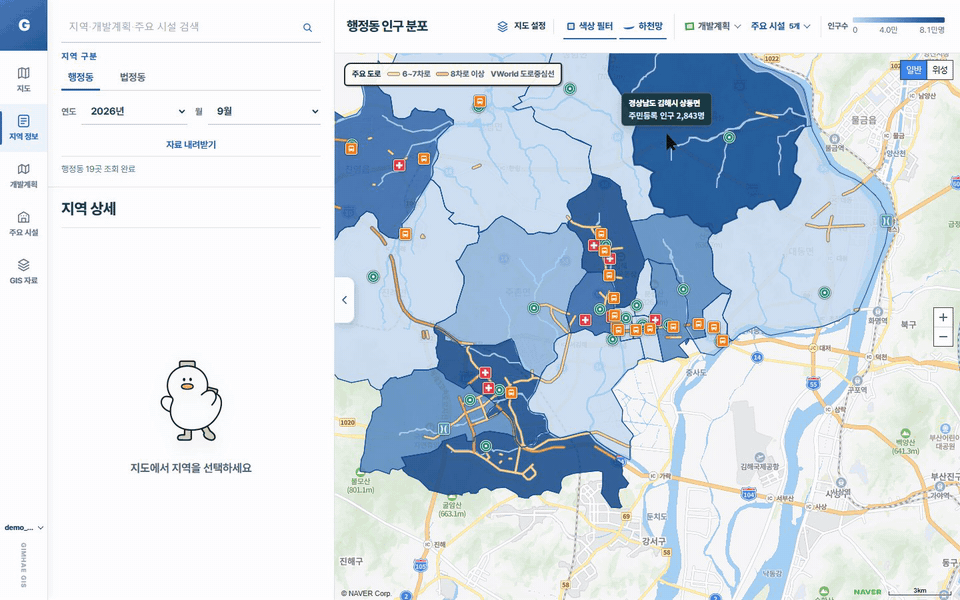
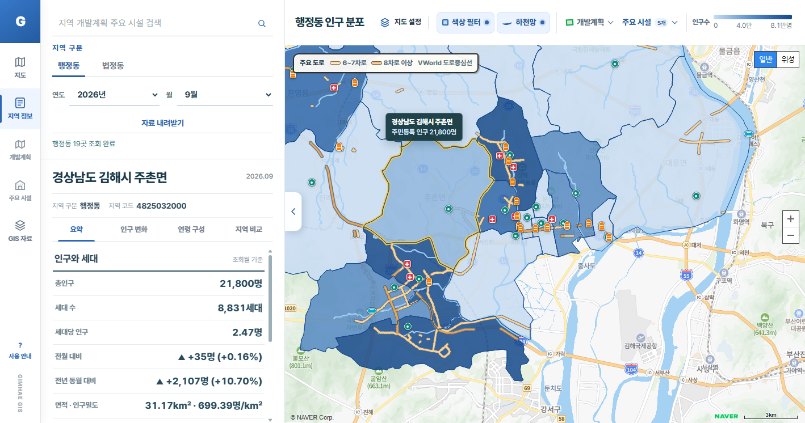
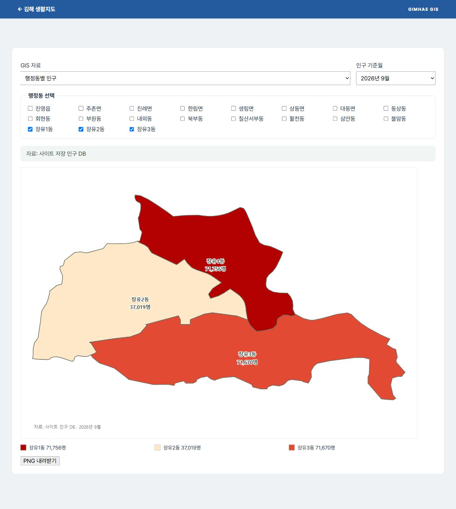
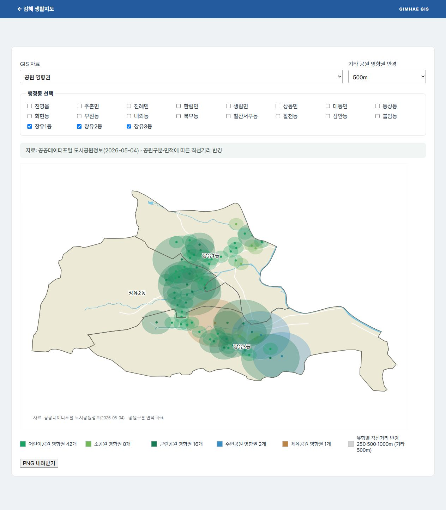
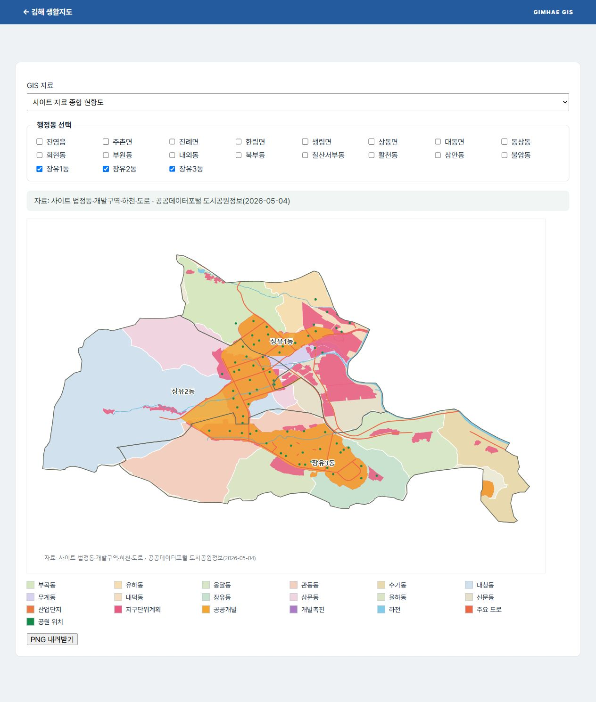

# 김해시 생활지도

김해시 생활지도는 **김해시의 인구와 공간 자료를 지역별로 살펴보는 웹사이트**입니다. 행정동·법정동과 기준월을 선택해 인구를 조회하고, 지도에서 하천·도로·개발구역·생활 시설을 함께 확인할 수 있습니다. GIS 자료 화면에서는 선택한 지역의 공간 자료를 새로 그려 PNG로 내려받을 수 있습니다.

## 사용 화면



*지역을 눌러 인구 통계를 보고, 시설 로드뷰, 행정동·법정동 전환, 기준월 변경, 시설 레이어 표시, 지도 확대·이동을 사용하는 모습입니다.*

## 메인 화면



*메인 화면 예시: 2026년 9월 주촌면을 선택하면 지도 경계와 인구·세대수·전월/전년 대비·인구밀도를 함께 볼 수 있습니다.*

## 이 웹사이트로 알 수 있는 것

### 지역별 인구 규모

행정동·법정동과 기준월을 바꿔 주민등록 인구를 조회할 수 있습니다. GIS 자료의 인구 지도에서는 선택한 행정동의 인구수와 지역 간 차이를 색상과 수치로 비교할 수 있습니다.



*예시: 2026년 9월 장유1·2·3동의 저장된 인구 자료.*

### 공원 주변의 영향 범위

공원 위치와 유형별 영향권을 지역 경계 위에 표시합니다. 범례에서 공원 유형과 표시된 지점 수를 확인하고, 다른 행정동을 조합하거나 영향권 반경을 바꿔 볼 수 있습니다. 영향권은 **직선거리 기준**이며 실제 도보 경로·이동 시간이나 공원 이용권을 뜻하지 않습니다. 초등학교 위치와 영향권도 GIS 자료에서 확인할 수 있습니다.



*예시: 장유1·2·3동의 공원 영향권. 사이트의 경계·공원 자료로 그린 결과입니다.*

### 지역 경계와 개발·자연환경의 위치 관계

종합 현황도에서 법정동 경계, 개발구역, 하천, 주요 도로와 공원 위치를 함께 볼 수 있습니다. 자료를 겹쳐 보면 개발구역이 어느 동에 걸치는지, 하천과 도로가 지역 사이를 어떻게 지나는지 살펴볼 수 있습니다. 지도에 표시된 개발구역의 세부 계획과 최신 상태는 해당 공식 고시를 별도로 확인해야 합니다.



*예시: 장유1·2·3동의 사이트 자료 종합 현황도.*

위 이미지는 실행 중인 웹사이트에서 생성한 화면을 캡처한 것입니다. 보고서 그림을 복사한 것이 아니며, 저장된 자료와 선택한 기준월에 따라 결과가 달라집니다. GIS 자료 화면은 현재 로컬 개발본 기준이며, 관련 코드는 아직 공개 저장소에 반영되지 않았습니다.

## 주요 기능

- 행정동·법정동 경계와 월별 주민등록 인구 조회
- 지역 선택, 지도 레이어 표시, 조회 결과 내보내기
- 주요 시설 위치와 시설 주변 로드뷰 확인
- 관리자가 발급한 일회용 코드로 회원가입 완료
- 저장된 공간 자료를 이용한 GIS 지도 생성 및 PNG 내려받기
- 인증된 관리자의 인구 데이터 동기화와 작업 상태 확인

## 프로젝트 구성

| 경로 | 내용 |
| --- | --- |
| `src/` | React 화면과 API 클라이언트 |
| `server/app/` | FastAPI, 데이터 저장·수집 명령 |
| `public/data/` | 브라우저에서 사용하는 공개 GeoJSON 자료 |
| `docs/images/` | README에 사용한 지도와 화면 이미지 |

## 로컬 실행

Node.js와 Python을 설치한 뒤 프로젝트 루트에 `.env` 파일을 만들고 `VITE_NAVER_MAP_CLIENT_ID`, `MOIS_SERVICE_KEY`, `VWORLD_API_KEY`, `ADMIN_USERNAME`, `ADMIN_PASSWORD_HASH`, `ADMIN_SESSION_SECRET` 값을 넣습니다.

```powershell
npm install
npm run dev
```

백엔드는 별도 터미널에서 실행합니다.

```powershell
cd server
python -m venv .venv
.\.venv\Scripts\python.exe -m pip install -r requirements.txt
.\.venv\Scripts\python.exe -m app.init_db
.\.venv\Scripts\python.exe -m uvicorn app.main:app --reload --port 8000
```

기존 DB가 없으면 인구 조회 결과가 비어 있을 수 있습니다.

### 로그인 설정

`.env`의 `ADMIN_PASSWORD_HASH`와 `ADMIN_SESSION_SECRET`이 비어 있으면 로그인이 503으로 실패합니다. `server` 폴더에서 값을 만들어 프로젝트 루트의 `.env`에 넣습니다. 해시는 `$`가 들어 있으므로 작은따옴표로 감쌉니다.

```powershell
.\.venv\Scripts\python.exe -m app.services.admin_auth
.\.venv\Scripts\python.exe -c "import secrets; print(secrets.token_urlsafe(32))"
```

- `ADMIN_PASSWORD_HASH`는 관리자 계정이 처음 만들어질 때만 쓰입니다. 이후 값을 바꿔도 적용되지 않습니다.
- 아이디와 비밀번호는 왼쪽 메뉴의 계정명을 눌러 바꿉니다(비밀번호는 `/admin`에서도 가능). 잊었을 때는 `.\.venv\Scripts\python.exe -m app.reset_admin_password admin`을 실행합니다.
- 로그인을 5번 틀리면 같은 IP에서 15분 동안 막힙니다. 로컬에서 바로 풀려면 서버를 끄고 `server\data\admin_login_attempts.db`를 지웁니다.
- 30분 동안 요청이 없거나 로그인 후 8시간이 지나면 다시 로그인해야 합니다. "로그인 유지"를 선택하면 로그아웃하거나 비밀번호를 바꿀 때까지 유지됩니다(최대 400일). 관리자 계정에는 적용되지 않습니다.
- 지역 인구 자료는 기본적으로 로그인해야 볼 수 있습니다. 공개하려면 `.env`에 `REQUIRE_LOGIN_FOR_POPULATION_DATA=false`를 넣습니다.

## 검증

```powershell
npm run lint
npm run build
npm run test:all
```

- `npm run test`: 프런트엔드 테스트(Vitest)만 실행합니다.
- `npm run test:server`: 백엔드 테스트(unittest)를 실행합니다. `server/.venv`가 있으면 그 Python을 쓰고, 없으면 시스템 `python`을 씁니다.
- `npm run test:all`: 린트, 프런트 테스트, 백엔드 테스트를 차례로 실행합니다.
