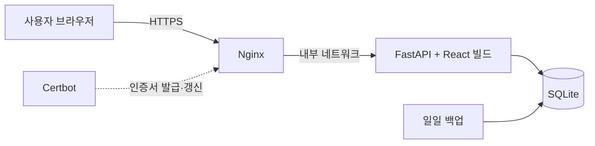

# 김해 생활지도

**김해시의 인구와 공간 자료를 지역별로 살펴보는 지도 서비스**

행정동·법정동과 기준월을 골라 인구를 조회하고, 
하천·도로·개발구역·생활 시설을 한 지도에서 함께 확인합니다.

 

  

 

## 이용 안내

**[https://gimhae.vmv-lab.com](https://gimhae.vmv-lab.com/)** 에 접속하면 바로 지도를 볼 수 있습니다. 인구 통계와 일부 자료는 로그인 후 이용할 수 있습니다.

| 구분 | 이용할 수 있는 기능 |
| --- | --- |
| **로그인 없이** | 지도와 지역 경계, 하천망, 주요 도로, 주요 시설 위치, 시설 로드뷰 |
| **로그인 후** | 지역별 인구 통계와 변화 추이, 개발계획, GIS 자료, CSV 내려받기 |

### 회원가입

1. 로그인 창의 `회원가입 신청`에서 아이디와 비밀번호를 정합니다.
2. 관리자에게 일회용 가입 코드를 받습니다. 코드는 24시간 동안 유효합니다.
3. `가입 코드 입력` 화면에 아이디와 코드를 넣으면 계정이 만들어집니다.

## 주요 기능

| 기능 | 설명 |
| --- | --- |
| **지역별 인구 조회** | 행정동·법정동과 기준월을 바꿔 주민등록 인구, 세대수, 전월·전년 대비, 인구밀도를 확인합니다. |
| **인구 분포 지도** | 지역 간 인구 차이를 색상으로 비교합니다. |
| **지도 레이어** | 하천망, 주요 도로, 개발구역과 행정복지센터, 의료, 학교, 교통거점, 공원 등 시설을 켜고 끕니다. |
| **시설 로드뷰** | 지도에서 시설을 누르면 주변 로드뷰를 바로 볼 수 있습니다. |
| **GIS 자료** | 선택한 지역의 공간 자료를 새로 그려 PNG로 내려받습니다. |
| **자료 내려받기** | 조회 결과를 CSV로 내려받습니다. |
| **관리자 기능** | 가입 코드 발급, 계정 관리, 인구 데이터 동기화와 작업 상태 확인을 제공합니다. |

## 화면 살펴보기

### 메인 화면

*2026년 9월 주촌면을 선택하면 지도 경계와 인구·세대수·전월/전년 대비·인구밀도를 함께 볼 수 있습니다.*

### GIS 자료

선택한 지역의 자료를 조합해 지도를 새로 그립니다.

<table>
  <tr>
    <th width="33%">인구 지도</th>
    <th width="33%">공원 영향권</th>
    <th width="33%">종합 현황도</th>
  </tr>
  <tr>
    <td></td>
    <td></td>
    <td></td>
  </tr>
  <tr>
    <td>선택한 행정동의 인구수와 지역 간 차이를 색상과 수치로 비교합니다.</td>
    <td>공원 유형별 영향권과 지점 수를 표시합니다. 다른 행정동을 조합하거나 반경을 바꿀 수 있습니다.</td>
    <td>법정동 경계, 개발구역, 하천, 주요 도로, 공원 위치를 겹쳐서 봅니다.</td>
  </tr>
</table>

> **자료를 볼 때 참고하세요**
> - 영향권은 **직선거리 기준**이며 실제 도보 경로·이동 시간이나 공원 이용권을 뜻하지 않습니다.
> - 개발구역의 세부 계획과 최신 상태는 해당 공식 고시를 별도로 확인해야 합니다.
> - 위 이미지는 웹사이트에서 생성한 화면이며, 저장된 자료와 선택한 기준월에 따라 결과가 달라집니다.

## 기술 스택

| 구분 | 사용 기술 |
| --- | --- |
| **Frontend** | React, TypeScript, Vite, TanStack Query, Naver Maps API |
| **Backend** | FastAPI, SQLAlchemy, SQLite, Shapely |
| **Infra** | Google Cloud VM, Docker Compose, Nginx, Let's Encrypt, Cloudflare DNS |
| **Test** | Vitest, unittest |

## 서비스 구성

Google Cloud VM 한 대에서 Docker Compose로 컨테이너를 실행합니다. 앱 포트는 외부에 열지 않고 Nginx를 통해서만 접근합니다.

## 프로젝트 구성

| 경로 | 내용 |
| --- | --- |
| `src/` | React 화면과 API 클라이언트 |
| `server/app/` | FastAPI, 데이터 저장·수집 명령 |
| `public/data/` | 브라우저에서 사용하는 공개 GeoJSON 자료 |
| `nginx/conf.d/` | HTTPS 연결과 요청 제한 등 Nginx 설정 |
| `docker-compose.prod.yml` | 운영 컨테이너 구성 |
| `docs/images/` | README에 사용한 지도와 화면 이미지 |

## 자료 출처

- 인구: 행정안전부 주민등록 인구 통계
- 공간 자료: VWorld, 김해시 UPIS
- 지도와 로드뷰: 네이버 지도
