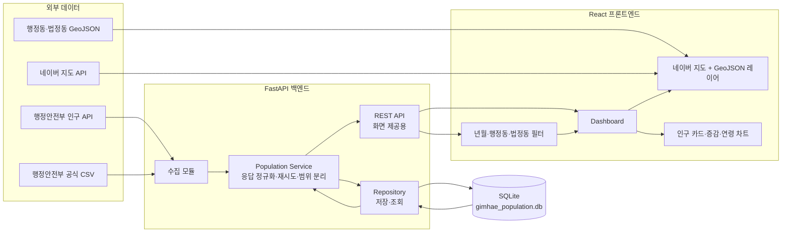
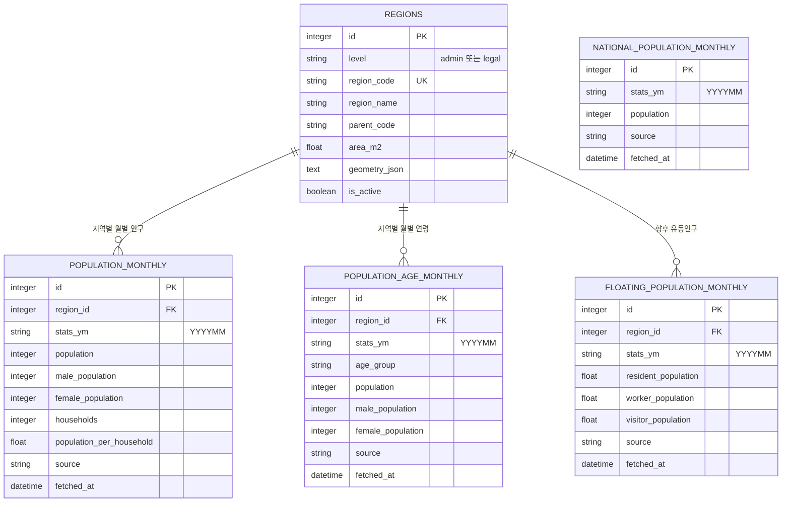
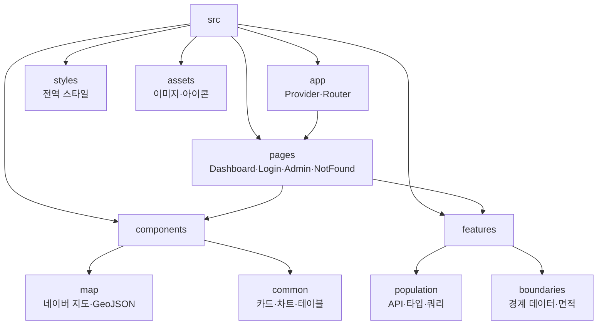
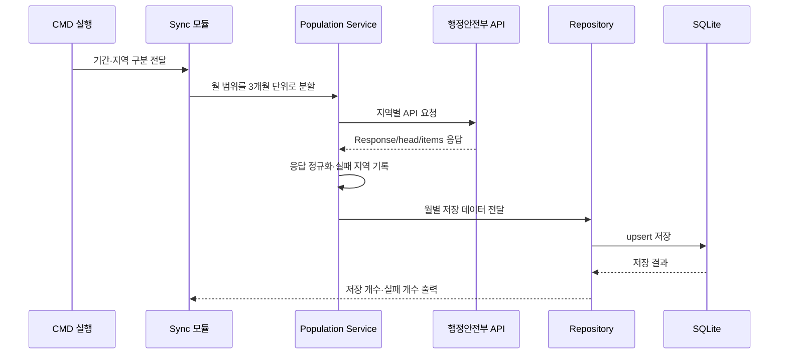

# 김해시 GIS 아키텍처

이 문서는 프로젝트의 구조를 그림으로 확인하기 위한 문서입니다.
GitHub에서는 Mermaid 다이어그램이 자동으로 렌더링됩니다.

## 1. 전체 시스템 구조



## 2. 데이터 저장 구조



### 중복 방지 기준

- `regions`: `level + region_code`
- `population_monthly`: `region_id + stats_ym`
- `population_age_monthly`: `region_id + stats_ym + age_group`
- `floating_population_monthly`: `region_id + stats_ym`
- `national_population_monthly`: `stats_ym`

## 3. 프론트엔드 폴더 구조



## 4. 월별 데이터 동기화 흐름



## 5. 구조별 책임

| 영역 | 책임 |
| --- | --- |
| React 화면 | 필터·지도·카드·차트 표시 |
| FastAPI API | 요청값 검증, DB 세션 주입, 서비스 오류를 HTTP 상태로 변환 |
| Service | 조회 결과 조합·응답 구성·비즈니스 규칙·외부 API 정규화 |
| Repository | SQLAlchemy를 통한 SQLite 저장·조회·중복 방지, 기존 인구 집계 쿼리 |
| SQLite | 월별·지역별 정제 데이터 보관 |
| 수집 스크립트 | 과거 데이터와 범위 데이터 적재 |
| GeoJSON | 행정구역 경계와 면적 계산 기준 |

화면 조회 경로는 `server/app/api/` → `server/app/services/` →
`server/app/repositories/` → SQLite 순서다. API는 `get_db` 의존성으로
요청별 세션을 주입하고, 서비스에는 그 세션을 인자로 전달한다. 데이터 수집
명령(`sync_*`, `import_*`)은 별도의 배치 진입점이며 기존 저장소 함수를 사용한다.
인구 저장소의 복잡한 집계 SQL과 결과 조립은 현재 함께 남아 있어, 저장소를
순수 CRUD 계층으로 만드는 추가 분리는 별도 작업이다.

## 6. 조회 가능 기간 확인

화면은 시작할 때 `GET /api/population/availability`를 호출합니다.
이 API는 행정동·법정동별로 다음 정보를 계산합니다.

- 저장된 기준년월 목록
- 해당 월의 저장 지역 수
- 기준 지역 수
- 월별 완전 적재 여부

따라서 아직 수집되지 않은 월은 화면의 선택 목록에 노출되지 않으며,
41개 법정동 중 일부만 저장된 월은 `complete: false`로 확인할 수 있습니다.

## 7. 기준월 비교 API

선택 지역의 임의의 두 기준년월을 비교할 때 다음 API를 사용합니다.

```text
GET /api/population/comparison
  ?level=admin
  &region_code=4825054000
  &base_ym=202412
  &target_ym=202512
```

응답에는 기준월 인구, 조회월 인구, 증감 인원, 증감률이 포함됩니다.
화면에서는 현재 조회월과 전월·전년 동월 비교를 유지하면서,
별도의 비교 기준월을 선택해 장기 변화도 확인할 수 있습니다.

## 8. 전국 인구 기준값 API

전국 인구밀도 비교를 위해 행정안전부 전국 주민등록 인구 합계를 별도로 저장합니다.
수집 스크립트가 원천 API의 전국 코드(`0`)를 조회하고, `lv=1` 시도 단위 응답이 오면 중복을 제거해 합산합니다.
브라우저는 원천 API를 직접 호출하지 않고 다음 저장 조회 API를 사용합니다.

```text
GET /api/national-population?year=2025&month=12
```

이 값은 이후 연도별 대한민국 국토면적 데이터와 결합하여
`전국 인구 ÷ 국토면적(km²)` 방식의 월별 전국 인구밀도 기준으로 사용합니다.
현재는 `NATIONAL_AREA_KM2` 환경변수의 기준면적을 사용하며,
향후 연도별 국토면적 테이블로 교체할 수 있습니다.

```text
GET /api/national-density?year=2025&month=12
```

화면에서는 지역 인구밀도를 전국 평균으로 나누어
전국 평균 대비 배수와 차이를 표시합니다.

## 9. 보안·운영 정책

- 브라우저에는 네이버 지도용 Client ID만 노출하고, 행정안전부 서비스 키는 백엔드 환경 변수로만 관리합니다.
- 저장 데이터 조회 API와 원천 API 프록시를 분리합니다. 원천 API 프록시는 기본 비활성화하며, 운영에서 활성화할 경우 인증과 요청 제한을 함께 적용해야 합니다.
- CORS 허용 Origin은 `CORS_ORIGINS`로 명시하고, 임의 Origin·자격 증명 공유·전체 헤더 허용을 사용하지 않습니다.
- `/login`과 `/admin`은 현재 화면 자리만 있는 상태이므로 실제 관리자 기능을 연결하기 전 서버 측 인증·권한 검사를 추가해야 합니다.

## 10. 주요 시설 데이터 품질 경로

시설은 `sync_vworld_facilities.py`가 VWorld 장소 검색 결과를 수집하고,
`facility_quality.py`의 규칙을 거쳐 `facilities` 테이블에 저장합니다.
화면 조회 경로는 `api/facilities.py` → `services/facility_service.py` →
`repositories/facility_repository.py` → SQLite입니다. 서비스 계층은 이미
저장된 행에도 표시용 품질 규칙을 다시 적용합니다. 이중 적용 덕분에 수집
규칙을 고친 뒤 DB 전체를 재수집하지 않아도 과거의 잘못된 POI를 화면에서
제외할 수 있습니다.

현재 병원 레이어는 동물병원을 제외하고, 법인명 접두어만 다른 병원과
`김해보건소`/`김해시보건소` 같은 표기를 하나로 묶습니다. 원본 행은 삭제하지
않습니다. API의 `fetchedAt`은 수집 시각이며 공식 검증 시각이 아닙니다.
학교는 경남교육청의 [김해 학교 목록](https://ghedu.gne.go.kr/ghedu/cm/cntnts/cntntsView.do?cntntsId=3264&mi=2492)과 대조해
합쳐진 캠퍼스 이름 두 건을 제외하고, 접두 지명만 다른 학교 POI는
350m 안에서 같은 학교명일 때 대표 지점 하나만 남깁니다.
공원은 대소문자만 다른 동일 이름이 30m 안에 겹칠 때만 한 점으로 묶습니다.
교통거점의 `활천역`은 운영사의 [인제대(활천)역 정보](https://www.bglrt.com/00011/00149.web?scode=913)에 맞춰
표시명을 바꿉니다. 수집 원본 이름·좌표는 유지합니다.
VWorld의 광역 검색에서 빠진 불암역·김해시청역·진영역은 정확한 역명으로
추가 조회합니다. 불암역과 김해시청역은 운영사 역정보의
[불암역](https://www.bglrt.com/00011/00149.web?scode=910)·[김해시청역](https://www.bglrt.com/00011/00149.web?scode=914)
도로명주소와 대조했고, 진영역은 [공공데이터포털의 현 역사 주소·좌표](https://www.data.go.kr/data/15034533/standard.do)와
대조해 옛 진영역 철도박물관 POI를 피합니다. 수집할 때 운영사 노선도의
김해 소재 12개 경전철역과 진영역이 모두 있는지 검사합니다. 시설명이
역사 내 상점이나 버스정류장인 POI는 교통거점으로 저장·표시하지 않습니다.

2026-09-22 동기화 전 활성 시설 476개의 좌표는 모두 현재 행정동
GeoJSON 경계 안에 있습니다. 표시 개수는 학교 138→119, 공원 274→273,
교통거점 15→18입니다. 동기화 후 DB 활성 시설은 479개입니다. 경계 검사는
운영 여부나 정확한 출입구 위치를 증명하지 않습니다. 경전철역과 진영역
외의 진례역·한림정역 및 김해여객터미널·장유여객터미널·진영시외버스터미널은
VWorld에 위치가 등록된 사실만 확인했으며, 현재 여객 취급·운행 상태는
공식 운행 자료로 검증하지 못했습니다. 따라서 이 다섯 곳의 지도 표시는
운영 보증이 아닙니다. 공원별 운영 상태도 공식 원장과 계속 대조해야 합니다.

## 11. 개발 고시 공식 원문 검증

`sync_official_notice_links.py`는 UPIS 개발 고시를 김해시 공식 고시공고와
국토교통부 토지이음 고시 원장에 대조합니다. 전체 동기화에서는 토지이음의
김해시 고시 목록을 100건 단위로 수집하고, DB의 미연결 고시와 로컬에서
비교합니다. 고시번호·고시일·문장부호를 제거한 제목·발행기관이 모두
일치해야 상세 URL을 저장합니다. 번호만 같거나 제목이 비슷한 자료는
연결하지 않습니다.

외부 URL은 서비스 계층에서 다시 허용 목록으로 검사합니다. 김해시청의
고유 관리번호가 있는 상세 URL과 토지이음의 숫자 `seq`가 있는 상세 URL만
API에 노출하며, UPIS 목록 주소나 임의 외부 주소는 빈 값으로 반환합니다.
2026-09-23 기준 활성 개발 고시 1,447건 중 921건이 검증됐습니다. 김해시는
903건, 경상남도는 13건, 국토교통부는 5건이며 나머지 526건은 공식 원문
미확인 상태를 유지합니다.
