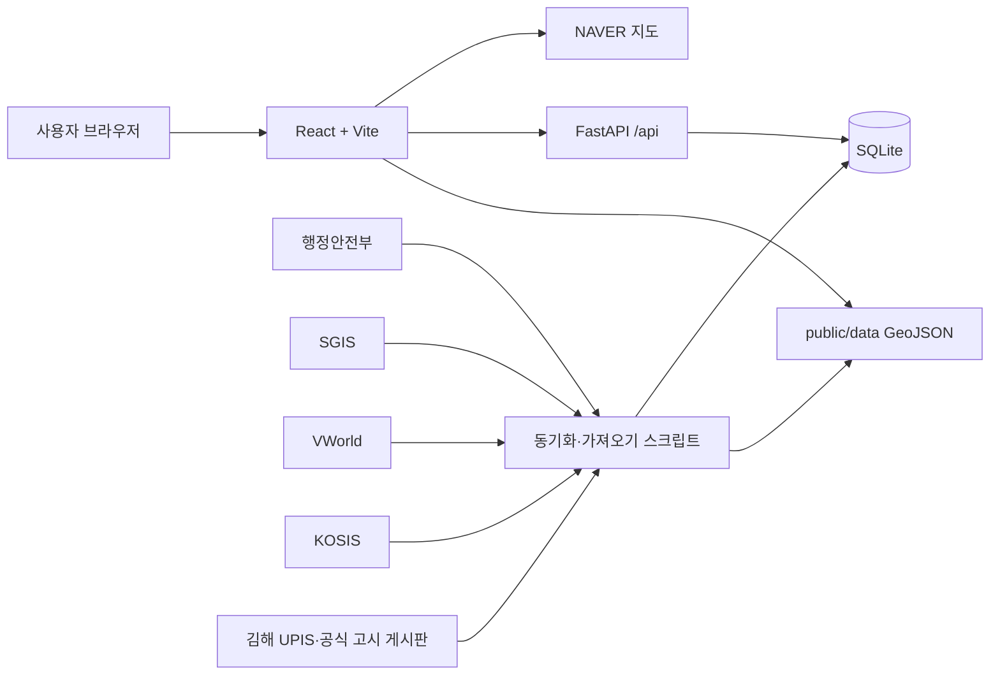

# 김해시 GIS 인구지도 프로젝트 인수인계

최종 정리일: 2026-09-22
프로젝트 경로: `C:\Users\User\Documents\ChatGPT\Gimhae_si_Map`
원격 저장소: `https://github.com/vmvvmvvmv/Gimhae_si_pop.git`

## 1. 프로젝트 목표

김해시의 행정동·법정동 경계를 지도에 표시하고, 월별 주민등록 인구와 면적을 결합해 다음 내용을 직관적으로 비교하는 웹 서비스다.

- 행정동·법정동별 인구 색상 지도
- 기준월과 비교월 사이 인구 증감
- 10세 단위 연령별 인구 분포
- 장기 월별 인구 추이
- 면적과 인구밀도 비교
- 면적이 비슷한 전국 행정동과 인구밀도 비교
- 행정복지센터, 의료, 학교, 교통, 교량, 공원, 시장 등 주요 시설
- 하천망과 도시개발·지구단위계획 등 행정구역 개편 참고 레이어
- 개발구역과 발행기관 공식 고시 원문 연결

유동인구·주거인구는 DB·API·적재 구조만 유지한다. 최신성과 사용 권한을 확인할 수 있는 데이터 공급원이 정해질 때까지 지도 분포 선택과 지역 상세 지표에서는 숨겨 둔다.

## 2. 기술 구성

| 영역 | 기술 |
|---|---|
| 프론트엔드 | React 19, TypeScript, Vite 8 |
| 라우팅 | React Router 7 |
| 서버 상태 | TanStack Query 5 |
| 입력 검증 | Zod 4 |
| 지도 | NAVER Maps JavaScript API v3 |
| 좌표 변환 | proj4 |
| 백엔드 | FastAPI, SQLAlchemy, httpx |
| 데이터베이스 | SQLite |
| 공간 처리 | Shapely, pyproj |



## 3. 주요 폴더와 책임

```text
Gimhae_si_Map/
├─ src/
│  ├─ app/                  앱 공급자와 라우터
│  ├─ pages/                대시보드·로그인·관리자·404 화면
│  ├─ components/
│  │  ├─ map/               NAVER 지도와 지도 레이어
│  │  └─ common/            연령 분포·장기 추이·지역 비교 차트
│  ├─ features/
│  │  ├─ population/        주민등록·유동인구 API 호출
│  │  ├─ boundaries/        GeoJSON 로딩과 공간 분석
│  │  ├─ facilities/        주요 시설 API 호출
│  │  └─ development/       개발 고시 API 호출
│  └─ assets/               김해 캐릭터 등 화면 자산
├─ public/data/             지도에 바로 올리는 GeoJSON
├─ server/app/
│  ├─ api/                  FastAPI 엔드포인트
│  ├─ repositories/         SQLite 조회·저장
│  ├─ services/             MOIS 등 외부 서비스 연동
│  ├─ models.py             SQLAlchemy 테이블 모델
│  └─ sync_*.py / import_*.py  데이터 동기화·가져오기 도구
├─ server/data/             로컬 SQLite DB와 원본 데이터
└─ docs/                    아키텍처와 인수인계 문서
```

핵심 파일:

- `src/pages/DashboardPage.tsx`: 대시보드 전체 상태와 화면 구성
- `src/pages/DashboardPage.css`: 대시보드 UI와 반응형 스타일
- `src/components/map/NaverMap.tsx`: 경계·시설·하천·개발구역 레이어와 지도 상호작용
- `server/app/main.py`: FastAPI 앱 생성, CORS, 보안 헤더, 라우터 등록
- `server/app/models.py`: SQLite 테이블 구조
- `server/app/api/population.py`: 김해 인구 조회·비교·추이 API
- `server/app/api/development.py`: 개발 고시 조회 API
- `docs/architecture.md`: 상세 아키텍처 문서

## 4. 데이터 파일과 경계 구분

- `public/data/gimhae_hangjeongdong.geojson`: 김해시 **행정동** 경계
- `public/data/Gimhae_si.geojson`: 김해시 **법정동** 경계
- `public/data/gimhae_waterways.geojson`: 김해시 범위로 자른 하천망
- `public/data/gimhae_development_areas.geojson`: VWorld 기반 개발 관련 구역

면적 표시는 km² 단위, 소수점 둘째 자리까지 사용한다. 초기 GeoJSON 투영 계산 면적에는 실제 공인 면적과 약 ±1km² 차이가 생길 수 있다는 안내를 넣었고, 이후 행정동 면적은 SGIS, 법정동 면적은 VWorld 기반 값으로 전환했다.

## 5. 데이터 출처와 현재 상태

| 데이터 | 출처 | 현재 상태 |
|---|---|---|
| 김해 행정동 주민등록 인구 | 행정안전부 API·과거 CSV | 사용자 확인상 2013-07부터 전체 기간 저장 완료 |
| 김해 법정동 주민등록 인구 | 행정안전부 API | 2022-10 이후 저장 대상으로 구성 |
| 10세 단위 연령 인구 | 행정안전부 성·연령 API | 지도 상세 패널에 시각화 |
| 전국 주민등록 인구 | 행정안전부 API | 월별 저장·조회 API 구현 |
| 전국 국토면적 | KOSIS 지적통계 또는 수동 입력 | 연도별 테이블과 밀도 계산 구현, 2025년 100,472.4km² 사용 이력 |
| 전국 행정동 면적 | SGIS 경계 | 2025년 3,559개 저장 실행 이력 |
| 김해 법정동 면적 | VWorld 경계 | 동기화·가져오기 구현 |
| 주요 시설 | VWorld 검색 API | 행정복지센터·의료·학교·대학·교통·교량·공원·시장 표시 |
| 하천망 | VWorld WFS | 김해시 범위로 잘라 표시 |
| 개발구역 | VWorld WFS | 최근 생성 결과 424개 구역 |
| 도시계획 고시 | 김해 UPIS | 2000-04~2026-07 개발 관련 1,447건 |
| 공식 고시 원문 | 김해시 공식 고시공고·토지이음·경상남도 고시공고 | 정확히 검증된 링크 949건, 과거 자료는 추가 검증 필요 |
| 유동·주거인구 | 향후 소상공인365 등 검토 | DB·API·화면 구조만 준비, 최신 데이터 미적재 |

개발구역 최근 생성 내역:

- 산업단지 32개
- 지구단위계획 211개
- 공공 개발사업 22개
- 개발진흥지구 159개
- 합계 424개
- VWorld 고시 식별자가 있는 구역 203개
- 고시 연결 240개 구역: 식별자 정확 일치 200개, 안전한 명칭 일치 40개
- 식별자 미확인 3개는 부산·창원 기관 코드로 김해 UPIS에서 조회되지 않음

공식 고시 링크 정책:

- 김해시 공식 게시판에서 고시번호, 고시일, 제목 유사도를 확인한 결과만 저장한다.
- 공식 URL에 `not_ancmt_mgt_no=`가 확인된 경우에만 프론트엔드로 전달한다.
- 일치하지 않는 고시를 비슷한 결과로 추정 연결하지 않는다.
- 제목을 누르면 김해시청 또는 토지이음 공식 고시 원문을 1200×850 팝업으로 연다.
- 공식 링크가 확인되지 않은 항목은 `공식 원문 링크 미확인`으로 표시한다.
- 경상남도·국토교통부 발행 고시는 김해시 게시판에 없을 수 있으므로 별도 공식 게시판 연동이 필요하다.

## 6. 구현 완료 기능

### 지도와 경계

- 행정동·법정동 전환
- 파란 계열 단계구분도
- `색상 필터`를 꺼 경계선만 보는 기능
- 색상 필터를 꺼도 범례의 `적음–많음` 색상 구분 유지
- 지역에 마우스를 올리면 지역명 표시
- 지역을 누르면 상세 패널 갱신
- 일반·위성 지도 전환, 지도 확대·축소
- 하천 색상 `#A5D1F2`
- 하천보다 행정 경계가 위에 그려지도록 레이어 순서 조정
- 경계선 두께 축소

### 인구 분석

- 선택 월 인구·세대·세대당 인구
- 기준월 대비 증감 수와 증감률
- 10세 단위 남녀 연령 분포
- 월별 장기 인구 추이와 마우스 오버 수치
- 면적과 km²당 인구밀도
- 전국 평균이 아니라 **면적이 비슷한 전국 행정동**과의 밀도 비교
- 면적 비교 게이지가 1배에서 항상 꽉 차 보이지 않도록 표현 개선

### 주요 시설과 생활권 참고 레이어

- `주요 시설` 한 줄형 제어 UI와 접기·펼치기
- 시설별 ON/OFF 상태를 시각적으로 명확히 표시
- 작은 지도 마커, 시설별 색상과 문양 구분
- 행정복지센터, 주요 의료, 학교, 대학, 교통거점, 교량, 공원, 시장·마트
- 선택한 시설만 지도에 표시

### 개발구역과 고시

- VWorld 개발구역 경계 표시
- 행정동·법정동의 면을 중복으로 덮지 않고 `MultiLineString` 경계선만 별도 생성해 개발구역 위에서도 모든 경계가 보이도록 처리
- 선 전용 경계는 클릭을 받지 않아 행정·법정동과 개발구역 클릭·호버가 모두 유지됨
- 개발구역이 겹친 지점은 포함 구역을 모두 찾아 작은 구역부터 선택 가능
- 개발계획 버튼을 누르면 주요 시설과 같은 팝업에서 표시 ON/OFF, 최근 연결 고시연도, `연도 미확인` 필터 제공
- 필터 팝업에 표시/전체/제외 건수, 상태 설명, 초기화와 닫기 버튼을 제공하며 모바일에서는 하단 패널로 표시
- 같은 팝업에서 구역 자체의 해제·취소·준공이 명확한 구역만 숨기는 필터 제공
- 마우스 오버 시 짧은 미리보기
- 클릭 시 연한 파란색 상세 팝업
- 팝업에서 모든 관련 고시 표시
- 검증된 고시 제목 클릭 시 발행기관 공식 원문 팝업
- 임의로 재구성한 내부 고시 상세 페이지는 제거
- 구역 경계 출처는 VWorld, 관련 고시 출처는 김해 UPIS로 화면에 명시

### UI 원칙

- 초기 참고 디자인의 굵은 제목, 둥근 카드, 선명한 외곽선·그림자 계열을 유지한다.
- 새 UI도 기존 화면과 같은 버튼 높이, 테두리, 간격, 폰트 계층을 사용한다.
- 개발 정보 팝업은 보라색 대신 연한 파란색을 사용하고 왼쪽의 진한 강조선은 사용하지 않는다.
- 선택 지역 상세 패널은 `요약 / 인구 변화 / 연령 구성` 탭으로 나누고, 데스크톱에서는 지역명·지역 코드를 고정한 채 내용만 스크롤한다. 모바일에서는 페이지 흐름에 맞춰 자연 높이로 펼친다.
- 선택 전 지역 상세에는 `src/assets/map_icon.png` 김해시 캐릭터를 약 150px로 표시한다.
- 지도 영역은 좌우 여백을 줄여 크게 사용한다.

## 7. SQLite 테이블

| 테이블 | 용도 | 주요 중복 방지 키 |
|---|---|---|
| `regions` | 행정동·법정동 기본정보와 면적 | level + region_code |
| `population_monthly` | 지역별 월 인구·세대 | region_id + stats_ym |
| `population_age_monthly` | 지역별 월·연령대 인구 | region_id + stats_ym + age_group |
| `national_population_monthly` | 전국 월별 인구 | stats_ym |
| `national_area_annual` | 전국 연도별 면적 | year |
| `national_administrative_area` | 전국 행정동 연도별 면적 | boundary_year + region_code |
| `national_legal_area` | 전국 법정동 기준연도별 면적 | reference_year + region_code |
| `national_administrative_population_monthly` | 전국 행정동 월 인구 | region_code + stats_ym |
| `facilities` | 주요 시설 좌표 | source + source_id |
| `development_notices` | UPIS 개발 관련 고시 | source + source_id |
| `floating_population_monthly` | 서비스·주거·직장·방문인구 | region_id + stats_ym |

실제 DB 기본 위치는 `server/data/gimhae_population.db`다. DB 파일은 Git에 올리지 않도록 설정되어 있으므로 다른 컴퓨터에서는 초기화와 동기화를 다시 해야 한다.

## 8. 백엔드 API

| 경로 | 역할 |
|---|---|
| `GET /api/health` | 서버 상태 확인 |
| `GET /api/population/regions` | 레벨·연월별 저장 인구 조회 |
| `GET /api/population/availability` | 저장된 조회 가능 기간 |
| `GET /api/population/comparison` | 기준월과 비교월 증감 |
| `GET /api/population/trend` | 선택 지역 장기 월별 추이 |
| `GET /api/population/admin-regions` | 행정동 월별 인구 |
| `GET /api/population/legal-regions` | 법정동 월별 인구 |
| `GET /api/population/admin-ages` | 실시간 행정동 연령 데이터; 기본 비활성화 |
| `GET /api/population` | 실시간 MOIS 프록시; 기본 비활성화 |
| `GET /api/national-population` | 전국 월별 인구 |
| `GET /api/national-density` | 전국 월별 인구밀도 |
| `GET /api/population/similar-density` | 비슷한 면적의 전국 행정동 비교 |
| `GET /api/facilities` | 카테고리별 주요 시설 |
| `GET /api/development/notices` | 개발구역과 연결할 고시 목록 |
| `GET /api/floating-population/availability` | 유동인구 저장 기간 |
| `GET /api/floating-population` | 월별 유동·주거·직장·방문인구 |

## 9. 환경 변수

`.env.example`을 참고하되 실제 키 값은 문서나 Git에 기록하지 않는다.

```dotenv
VITE_NAVER_MAP_CLIENT_ID=
VITE_API_BASE_URL=http://127.0.0.1:8000/api
MOIS_SERVICE_KEY=
SGIS_CONSUMER_KEY=
SGIS_CONSUMER_SECRET=
SGIS_ACCESS_TOKEN=
VWORLD_API_KEY=
VWORLD_API_DOMAIN=http://localhost:5173
CORS_ORIGINS=http://localhost:5173,http://localhost:5174
ENABLE_LIVE_MOIS_PROXY=false
NATIONAL_AREA_KM2=100472.4
```

주의:

- `VITE_` 접두사의 값은 브라우저 번들에 노출될 수 있다. 비밀키에는 사용하지 않는다.
- MOIS, SGIS, VWorld 비밀키는 백엔드에서만 읽는다.
- NAVER Maps 콘솔의 Web 서비스 URL에 실제 개발 포트가 등록되어 있어야 한다.
- `.env`가 외부 공유나 커밋된 적이 있다면 해당 키는 재발급한다.

## 10. CMD에서 실행하는 방법

### 백엔드

```bat
cd /d "C:\Users\User\Documents\ChatGPT\Gimhae_si_Map\server"
.venv\Scripts\python.exe -m pip install -r requirements.txt
.venv\Scripts\python.exe -m uvicorn app.main:app --reload --port 8000
```

이 창은 FastAPI 서버를 실행한다. `--reload`는 Python 파일을 저장하면 서버를 자동 재시작한다.

확인:

```bat
curl "http://127.0.0.1:8000/api/health"
```

### 프론트엔드

새 CMD 창에서 실행한다.

```bat
cd /d "C:\Users\User\Documents\ChatGPT\Gimhae_si_Map"
npm install
npm run dev
```

Vite가 출력한 주소를 브라우저에서 연다. 5173 대신 5174가 뜨면 NAVER Maps와 CORS 허용 URL도 확인한다.

### 품질 확인

```bat
cd /d "C:\Users\User\Documents\ChatGPT\Gimhae_si_Map"
npm run lint
npm run build

cd server
.venv\Scripts\python.exe -m compileall -q app
```

최근 작업 시점에는 위 프론트엔드 lint·build와 Python 문법 검사가 통과했다.

## 11. 주요 데이터 작업 명령

각 명령은 `server` 폴더에서 실행한다.

```bat
REM SQLite 테이블과 김해 경계 기본정보 생성
.venv\Scripts\python.exe -m app.init_db

REM 행정동 또는 법정동의 한 달 인구 저장
.venv\Scripts\python.exe -m app.sync_population --level admin --year 2025 --month 12
.venv\Scripts\python.exe -m app.sync_population --level legal --year 2025 --month 12

REM 김해 월별 인구 범위 동기화
.venv\Scripts\python.exe -m app.sync_population_range --from-year 2024 --from-month 1 --to-year 2025 --to-month 12 --delay-seconds 0.8

REM 전국 월별 인구 저장
.venv\Scripts\python.exe -m app.sync_national_population --from-year 2013 --from-month 7 --to-year 2025 --to-month 12 --delay-seconds 0.8

REM 전국 행정동 면적 동기화
.venv\Scripts\python.exe -m app.sync_sgis_admin_area_range --from-year 2013 --to-year 2025

REM 김해 법정동 경계·면적
.venv\Scripts\python.exe -m app.sync_vworld_legal_areas --sigungu-code 48250 --reference-year 2025

REM 하천·개발구역·시설
.venv\Scripts\python.exe -m app.sync_vworld_waterways
.venv\Scripts\python.exe -m app.sync_vworld_development_areas
.venv\Scripts\python.exe -m app.sync_vworld_facilities --category ADMIN_CENTER
.venv\Scripts\python.exe -m app.sync_vworld_facilities --category BRIDGE
.venv\Scripts\python.exe -m app.sync_vworld_facilities --category PARK

REM UPIS 개발 고시와 검증된 발행기관 공식 원문 링크
.venv\Scripts\python.exe -m app.sync_upis_development_notices --from-date 20000101 --to-date 20260921
.venv\Scripts\python.exe -m app.sync_official_notice_links --concurrency 3 --delay-seconds 0.2

REM 미연결 고시 원인 보고서(CSV·Markdown, DB 수정 없음)
.venv\Scripts\python.exe -m app.audit_official_notice_mismatches --concurrency 3 --delay-seconds 0.2
```

날짜 범위와 지연 시간은 실행 시점과 공공 API 정책에 맞춰 조정한다. 대량 호출은 서버 부담과 호출 제한을 고려해 지연 시간을 둔다.

## 12. 보안과 유지보수 원칙

- `.env`, 가상환경, 캐시, SQLite DB, 원본 CSV는 커밋하지 않는다.
- 실시간 MOIS 프록시는 `ENABLE_LIVE_MOIS_PROXY=false`가 기본이다.
- 지역 코드는 서버에서 길이와 숫자 형식을 검증한다.
- 외부 API의 내부 오류·키·전체 응답을 사용자에게 그대로 노출하지 않는다.
- CORS는 `CORS_ORIGINS`에 지정된 주소만 허용한다.
- 자격 증명 허용과 모든 헤더 허용을 사용하지 않는다.
- 지도 라벨 등 외부 문자열은 HTML 이스케이프 후 표시한다.
- 관리자·로그인 화면은 현재 UI 골격일 뿐 실제 인증·권한 제어가 아니다. 관리자 기능을 공개하기 전에 서버 인증을 구현해야 한다.
- 외부 사이트 연결은 확인된 공식 URL만 허용한다.

## 13. 알려진 한계와 확인할 사항

1. **현재 Git 상태**: 2026-09-22 로컬 첫 커밋을 만들면서 `.gitignore`를 점검했다. `.env`, `server/data/` 전체(DB·백업·임시 부속 파일·수집 원본), 가상환경, 빌드 산출물, `server/app/models.py.bak`는 Git에서 제외한다. 공개 가능한 `.env.example`과 화면용 `public/data/*.geojson`은 포함한다. `origin`은 연결되어 있지만 이 작업에서 원격으로 push하지 않았다. 원격 이력을 확인한 뒤 병합·push 방식을 결정해야 한다.
2. **공식 고시 링크**: 개발 고시 1,447건 중 949건을 김해시 공식 고시공고·토지이음·경상남도 공식 고시공고 상세 원문과 정확히 연결했다. 번호·날짜·정규화한 제목·발행기관이 모두 일치한 경우만 저장한다. 나머지 498건은 추정 URL을 만들지 않는다.
3. **타 기관 고시**: 현재 연결 수는 김해시 903건, 경상남도 41건, 국토교통부 5건이다. 미확인 자료는 김해시 256건, 경상남도 229건, 국토교통부 13건이다. 경상남도 미확인 자료는 공식 게시판에 없거나 UPIS와 제목·게시일 표기가 달라 자동으로 연결하지 않았다. 토지이음 검색 목록에서 빠진 오래된 원문은 상세 화면을 직접 대조한 뒤 `REVIEWED_EUM_CANDIDATES`에 남긴다.
4. **유동·주거인구**: 현재 준비된 공공 파일은 2021-10~2022-09 참고용이라 최신 분석에 쓰지 않기로 했다. 소상공인365는 이용 조건과 반출 가능 범위를 먼저 확인해야 한다.
5. **전국 유사 면적 비교**: 전국 행정동별 인구가 없는 월에는 면적 후보만 나오고 인구밀도가 `null`일 수 있다. 해당 월 전국 행정동 인구 동기화가 필요하다.
6. **팝업 차단**: 브라우저 설정에 따라 공식 고시 팝업이 차단될 수 있다.
7. **Python GIS DLL**: 일부 PC의 애플리케이션 제어 정책이 `pyproj` DLL을 차단한 이력이 있다. 이 경우 허용된 Python 환경 또는 정책 예외가 필요하다.
8. **반응형 확인**: 주요 시설 종류가 많아 좁은 화면에서 접기·줄바꿈·겹침을 실제 브라우저 크기별로 다시 점검해야 한다.
9. **정리 후보**: `server/app/models.py.bak`가 남아 있다. 실제 필요 여부를 확인한 뒤 삭제할 수 있지만 사용자 확인 없이 제거하지 않는다.

## 13-1. 서비스 계층과 트랜잭션 보완

- 화면 조회는 `api → services → repositories → SQLite` 방향을 유지한다.
- 인구·시설·개발고시처럼 반복 실행하는 핵심 배치 저장은 `sync → *_sync_service → repositories` 방향으로 정리했다.
- 리포지토리는 더 이상 `commit()`하지 않고 SQL 실행과 `flush()`까지만 담당한다.
- 배치 진입점이 `SessionLocal.begin()`으로 커밋·롤백 범위를 소유한다.
- 개발 고시의 기존 범위 비활성화와 신규 저장은 하나의 트랜잭션이다.
- 요청별 DB 세션은 예외 발생 시 명시적으로 롤백한다.
- SQLAlchemy 오류는 상세 내용을 서버 로그에 남기고 사용자에게는 안전한 500 응답만 반환한다.
- 강제 실패 시 전체 롤백과 DB 내부 메시지 비노출을 자동 테스트로 검증한다.
- 초기 DB 생성과 일부 일회성 파일 가져오기 도구는 아직 모델을 직접 다루지만, 모두 `SessionLocal.begin()`으로 원자성을 보장한다.

## 14. 다음 작업 권장 순서

1. `app.audit_official_notice_mismatches`로 남은 공식 원문 498건을 점검한다. 결과는 `server/data/reports/`에 저장되며 번호 후보 없음·기관·날짜·제목 불일치로 구분된다. 이 명령은 DB를 수정하지 않으며, **정확 일치가 증명된 링크만** 별도 동기화한다.
2. 원격 Git 이력을 확인한 뒤 로컬 첫 커밋과 병합·push하는 안전한 방법을 정한다. 강제 push는 하지 않는다.
3. 행정동·법정동별 데이터 누락 월, 연령 데이터, 전국 비교 데이터를 자동 점검하는 검증 명령을 만든다.
4. 프론트엔드와 백엔드 테스트를 추가한다. 특히 지역 코드 매칭, 비교월 계산, 레이어 클릭 순서, 공식 링크 검증을 우선한다.
5. 관리자 페이지를 사용할 계획이면 로그인 UI보다 서버 세션·권한·감사 로그를 먼저 구현한다.
6. 최신 유동·주거인구 데이터의 계약·이용 권한을 확정한 뒤 `floating_population_monthly`로 가져온다.
7. 배포 환경에서는 HTTPS, 운영 CORS, API 속도 제한, 백업, 스케줄 동기화를 구성한다.

## 15. 다음 채팅에 전달할 시작 문구

아래 내용을 새 채팅의 첫 메시지로 붙여 넣으면 된다.

```text
C:\Users\User\Documents\ChatGPT\Gimhae_si_Map 프로젝트 작업을 이어서 해줘.
먼저 docs/project-handoff.md, docs/architecture.md, README.md를 전부 읽고 현재 git status와 관련 파일을 확인해줘.

이 프로젝트는 React + TypeScript + Vite 프론트엔드, FastAPI + SQLite 백엔드, NAVER Maps를 사용하는 김해시 행정동/법정동 인구 GIS야. 기존 UI 스타일과 보안 원칙을 유지하고, 실제 파일을 확인하기 전에는 구조나 데이터 상태를 추정하지 마.

중요 원칙:
- 명령어는 Windows CMD 기준으로 알려주고, 왜 실행하는지도 설명할 것
- 내가 직접 체험할 수 있는 작은 단계도 가능하면 하나 남겨줄 것
- .env 실제 키와 SQLite DB를 Git에 올리지 말 것
- 공식 고시 링크는 정확히 검증된 원문만 연결하고 추정 URL은 만들지 말 것
- 새 UI는 기존 굵은 제목·둥근 카드·외곽선·그림자·연한 파란색 계열과 맞출 것
- 노션은 내가 따로 요청하지 않으면 수정하지 말 것

이번에 이어서 할 작업: [여기에 원하는 다음 작업을 적기]
```
